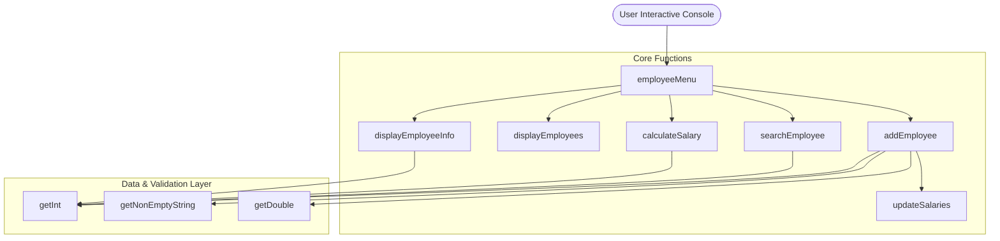
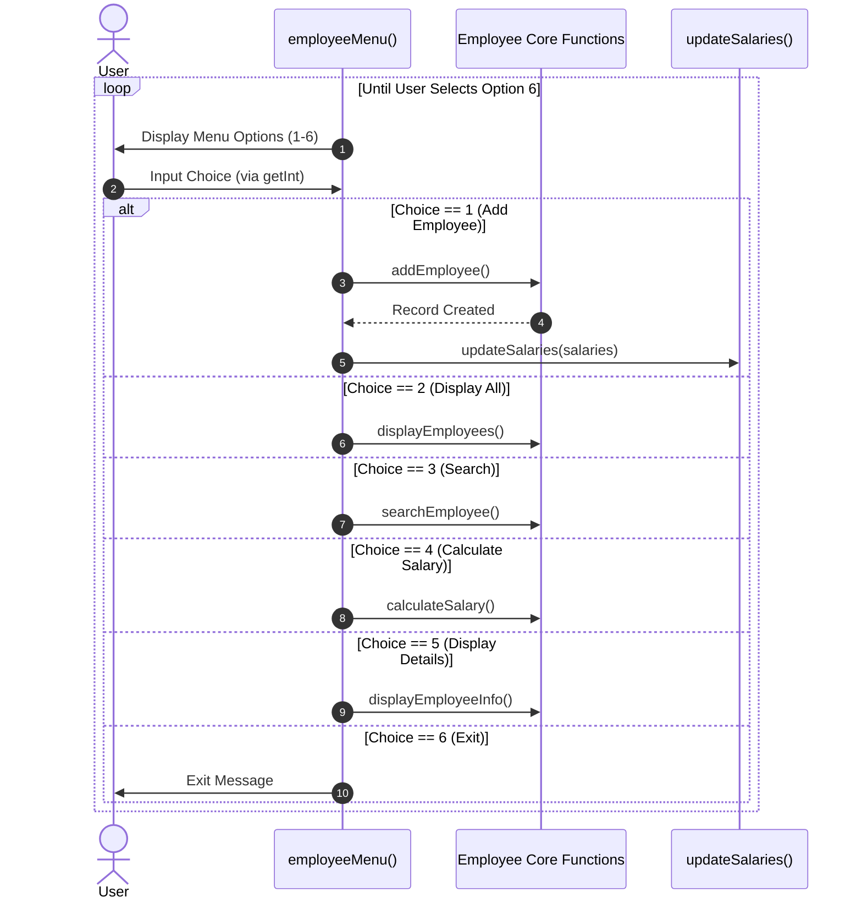
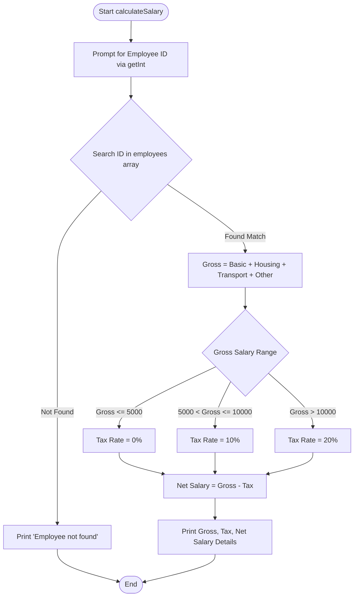
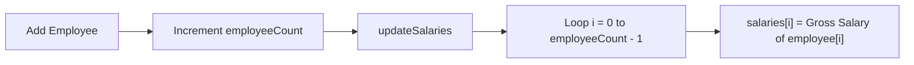

# Employee Management System (`employees.c`) Documentation

This document provides a comprehensive technical overview and visual architecture of the `employees.c` module, outlining its internal data structures, exported functions, execution flow, and business logic.

---

## 1. Overview & Architecture

The `employees.c` module provides core record management and calculation features for the Employee Management System. It relies on internal static state (`struct Employee employees[]` array and counter `employeeCount`) and interfaces with external input validation helpers defined in `validation.h`.

---

## 2. Data Structures

### `struct Employee`
Represents an individual employee record within the system.

| Field | Data Type | Description |
| :--- | :--- | :--- |
| `employeeID` | `int` | Unique identifier (valid range: 1 to 999,999) |
| `name` | `char[50]` | Employee's full name |
| `department` | `char[50]` | Assigned department name |
| `basicSalary` | `float` | Base compensation value |
| `housingAllowance` | `float` | Housing allowance compensation |
| `transportAllowance` | `float` | Transportation allowance |
| `otherAllowance` | `float` | Additional miscellaneous allowances |

---

## 3. Function Details & Sequence Flows

### 3.1 Main Menu Loop (`employeeMenu`)
- **Inputs:** `double salaries[]` array (external array updated upon employee additions).
- **Outputs:** Returns `int` representing total `employeeCount`.
- **Logic:** Displays the main menu options continuously until option `6` (Exit) is selected.

---

### 3.2 Tax & Net Salary Logic (`calculateSalary`)

Calculates gross salary, progressive tax brackets, and net pay for a specific employee ID.

#### Tax Calculation Rules:
$$ \text{Gross Salary} = \text{Basic} + \text{Housing} + \text{Transport} + \text{Other} $$

$$
\text{Tax} = 
\begin{cases} 
0 & \text{if } \text{Gross} \le 5000 \\
0.10 \times \text{Gross} & \text{if } 5000 < \text{Gross} \le 10000 \\
0.20 \times \text{Gross} & \text{if } \text{Gross} > 10000
\end{cases}
$$

$$ \text{Net Salary} = \text{Gross Salary} - \text{Tax} $$

---

### 3.3 Salary Synchronization (`updateSalaries`)
- **Purpose:** Synchronizes gross salaries from internal `Employee` structures to the external `salaries[]` buffer for reporting modules.
- **Trigger:** Invoked immediately after successfully adding a new employee.

---

## 4. Key Implementation Highlights

1. **Input Validation Integration:** 
   Uses safe input functions `getInt()`, `getDouble()`, and `getNonEmptyString()` to prevent overflow and handle invalid user inputs.
2. **Fixed Array Limit Handling:** 
   Validates maximum array bounds against `MAX_EMPLOYEES` prior to adding new records.
3. **Data Integrity:** 
   Calculates allowances dynamically when generating gross salary metrics rather than storing pre-computed gross values.